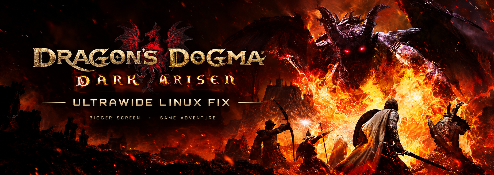
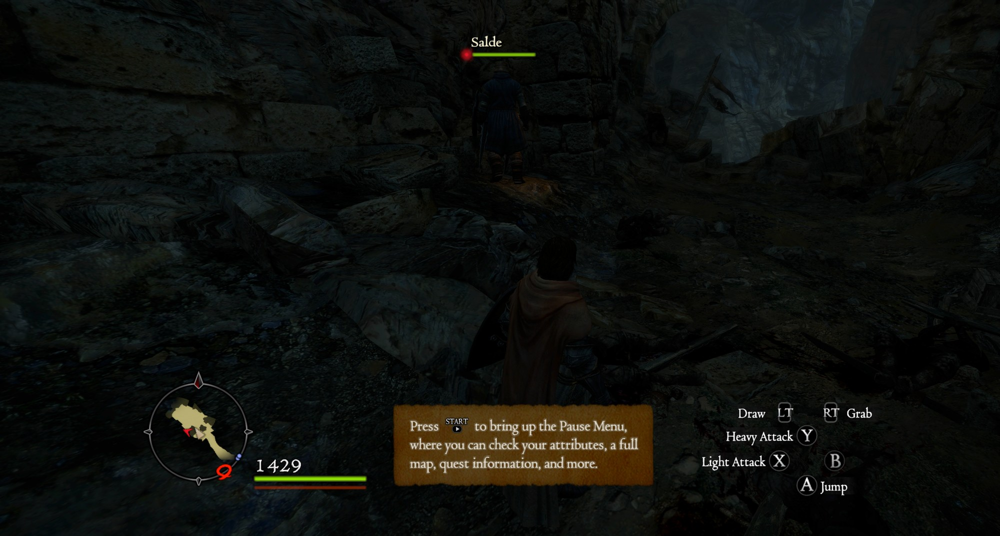

<p align="center"></p>

<h1 align="center">Dragon's Dogma: Dark Arisen Ultrawide Fix</h1>

<p align="center"><b>Fill your 21:9 or 32:9 monitor, keep the HUD exactly where Capcom put it. One command, then play.</b><br>
Linux · Proton · Steam Deck friendly · Windows (manual)</p>

<p align="center">
  
  
  
  
</p>

<p align="center"><i>"Rise, Arisen. The world is wider than you knew."</i></p>

<p align="center">🇧🇷 <b><a href="README.pt-BR.md">Leia em português →</a></b></p>

---

## What is this?

Dragon's Dogma: Dark Arisen is a 2016 port of a 2012 console game. It lets you pick 3440x1440, but then it **crops the vertical field of view** (you see less of the sky and the ground than a 16:9 player) and **stretches the HUD** across the whole width, so the minimap, the health bar and the pawn messages end up smeared along the edges.

**This installer fixes both in one command.** It installs [DDDAFix](https://github.com/Lyall/DDDAFix) by Lyall, the runtime patch that gives the game a correct field of view at any aspect ratio and keeps the HUD in a centred 16:9 box, and it takes care of the one thing Linux needs on top: the Steam launch option that lets Proton load it. Nothing in the game's files is modified.

- 🖥️ **Edge to edge.** The world fills the monitor with a true Hor+ field of view: you see more to the sides, never less above and below.
- 🎯 **HUD at 16:9, where it belongs.** Minimap, health, stamina, pawn chatter and the action palette stay in the centred box the game was designed for. No stretched icons, no elements pushed off-screen.
- 🪟 **Borderless fullscreen.** Set the game to *Windowed* and it covers the screen with no border, so alt-tab is instant.
- 🐧 **Linux first.** Finds the game in every Steam library, writes the `WINEDLLOVERRIDES` launch option for you and plays nice with ReShade, gamescope and `dinput8`-based mods already on the line.
- 🧰 **Zero hex editing.** The `DDDA.exe` is never touched. Uninstall with one flag and the folder is back to stock.

---

## Screenshot

<p align="center"><br><sub>3440x1440 on Linux (GE-Proton 11). The scene fills the monitor; the minimap, health bar, tutorial box and action palette stay inside the centred 16:9 area.</sub></p>

---

## Quick start

```sh
curl -fsSL https://raw.githubusercontent.com/sidnei-almeida/ddda-ultrawide-fix/main/install.sh | bash
```

| Step | What to do |
|:---:|---|
| 1 | **Close Steam** (so the script can write the launch option) and run the one-liner above. |
| 2 | Open Steam and start the game. In **Options → Graphics**, choose your monitor's native resolution and *Windowed* mode (the fix turns it into borderless fullscreen). |
| 3 | **Play.** `DDDAFix.log` appears next to `DDDA.exe` the first time the fix loads. |

Or clone the repo and run `./install.sh`. Either way, the script is idempotent: run it again after a game update, a reinstall or a Proton change and it only fixes what is missing.

---

## What the script does

1. **Verifies the payload.** Every file is checked against `payload/SHA256SUMS` before anything is copied.
2. **Finds the game.** It reads `installdir` from `appmanifest_367500.acf` in every Steam library (native, Flatpak and Snap installs), then looks in Heroic, Lutris and Bottles. Pass `--path` if you keep it somewhere unusual.
3. **Installs DDDAFix.** `winmm.dll` (Ultimate ASI Loader) and `DDDAFix.asi` go next to `DDDA.exe`. A `winmm.dll` that is already there and is not ours is backed up as `winmm.dll.bak`. Your `DDDAFix.ini` is kept if you already tuned it.
4. **Sets the Steam launch option.** Proton ships its own `winmm.dll`, so the game has to be told to prefer the one in its folder. The script merges `winmm` into whatever `WINEDLLOVERRIDES` list you already have, so ReShade's `d3d9`, a `dinput8` mod loader, gamescope flags and anything else on the line survive. If Steam is open, it prints the exact line to paste instead.

```
./install.sh [--path <game dir>]... [--uninstall] [--dry-run] [--no-launch-options] [--reset-ini]

  --path DIR            Game folder containing DDDA.exe (can be given more than once).
  --uninstall           Remove the fix and the launch option, restore a backed-up winmm.dll.
  --dry-run             Show what would be done without changing anything.
  --no-launch-options   Leave Steam's launch options alone.
  --reset-ini           Overwrite DDDAFix.ini with the shipped defaults.
```

---

## Manual install (Linux or Windows)

Copy the three files from [`payload/`](payload) into the folder that contains `DDDA.exe`:

```
DDDA/
├── DDDA.exe
├── winmm.dll        ← Ultimate ASI Loader
├── DDDAFix.asi      ← the fix
└── DDDAFix.ini      ← its settings
```

On Windows that is all. On Linux also add the launch option in Steam → Dragon's Dogma: Dark Arisen → Properties → Launch options:

```
WINEDLLOVERRIDES="winmm=n,b" %command%
```

If you already have an override list, add `winmm` to it: `WINEDLLOVERRIDES="d3d9,winmm=n,b" %command%` (ReShade), `WINEDLLOVERRIDES="d3d9,dinput8,winmm=n,b" %command%` (ReShade plus a `dinput8` mod loader).

---

## Settings

Everything lives in `DDDAFix.ini` in the game folder. Changes apply on the next launch, no reinstall needed.

| Section | Default | What it does |
|---|:---:|---|
| `[Fix HUD]` | on | Keeps the HUD in a centred 16:9 box and fixes stretched elements. |
| `[Fix FOV]` | on | Hor+ field of view at any aspect ratio. |
| `[Borderless Windowed Mode]` | on | *Windowed* in the game's options becomes borderless fullscreen. |
| `[Disable Pause on Focus Loss]` | off | Keeps the game running when you alt-tab. Handy on a second monitor. |
| `[Raise Framerate Cap]` | off | Raises the "variable" framerate cap from 150 to 1000 fps. The game's physics are tied to the frame rate, so leave this off unless you know what you are doing. |

---

## Going further: supersampling with gamescope

A 2012 engine at 3440x1440 shimmers on grass, hair and fences, and the game has no temporal anti-aliasing. The cleanest answer on Linux is to render above the monitor and let gamescope scale it down. Put this in the launch options (keep the override list you already have):

```
WINEDLLOVERRIDES="winmm=n,b" gamescope -W 3440 -H 1440 -w 4300 -h 1800 -r 100 -f -- %command%
```

`-W/-H` is the monitor, `-w/-h` the render size (here 1.25x) and `-r` the refresh rate. In the game, pick the render resolution (4300x1800) in the graphics options. DDDAFix computes everything from the resolution the game runs at, so the HUD and FOV stay correct. 1.5x (`-w 5160 -h 2160`) looks even better but the game is a 32-bit DirectX 9 process: every buffer counts against a 4 GB limit, and with large texture packs 1.25x is the safer choice.

---

## Troubleshooting

| Problem | Fix |
|---|---|
| **No `DDDAFix.log` in the game folder** | The fix never loaded. On Linux the launch option is missing or Steam was open when the installer ran: run `./install.sh` again with Steam closed, or paste the line by hand. Check that `winmm.dll` sits next to `DDDA.exe`, not in `nativePC`. |
| **Black bars or stretched HUD are still there** | The game is running at a 16:9 resolution. Pick your monitor's native resolution in Options → Graphics. |
| **Game window has a border or sits in a corner** | Choose *Windowed* in the game's display mode. DDDAFix turns it into borderless fullscreen. |
| **The game pauses when I alt-tab** | Set `Enabled = true` under `[Disable Pause on Focus Loss]` in `DDDAFix.ini`. |
| **The game crashes at the title screen with mods installed** | Title-screen video mods with 5.1 audio (for example *Dark Arisen Title Screen Revival*) crash XAudio2 under Proton. Disable the mod or restore the original `nativePC/movie/title` files. |
| **Instant crash with a `dinput8.dll` mod loader (camera tweaks, Arcs loader)** | Its hotkey hook fails under Proton and jumps to a null pointer. Set `enabled = off` under `[hotkeys]` in `dinput8.ini`; everything else in that loader keeps working. |
| **Crashes in busy areas with big texture packs** | The game is 32-bit with a 4 GB ceiling (the Steam `DDDA.exe` already has the Large Address Aware flag). Lower the render resolution, drop supersampling, or remove the heaviest pack. |
| **A game update broke it** | DDDAFix finds its patch sites by byte pattern, so updates usually survive. If `DDDAFix.log` shows "pattern not found", open an issue with the log. |

<p align="center"><a href="https://github.com/sidnei-almeida/ddda-ultrawide-fix/issues"></a></p>

---

## FAQ

**Why not AgDrag?** Kaldaien's [AgDrag](https://github.com/Kaldaien/AgDrag) (2016) is often linked as "the" ultrawide fix, but its purpose is different: it keeps the game rendering in the background and blocks a few keys, and its aspect-ratio support is an experimental map fix. It also ships its own `d3d9.dll`, which collides with ReShade and ENB. DDDAFix does the actual FOV and HUD work and coexists with everything.

**Can the HUD go to the screen edges instead of staying at 16:9?** The game draws the HUD as one 16:9 canvas, and every widget computes its screen transform through the same routine. We prototyped anchoring individual widgets (minimap, action palette, pawn messages) to the edges by hooking that routine and identifying each widget by its runtime class name. It works, but the minimap terrain is drawn by a separate path and the result looked oversized and out of place. The centred 16:9 HUD is what the game was designed for and what this project ships.

**Does it work with ReShade?** Yes. ReShade installs as `d3d9.dll`; add it to the override list (`WINEDLLOVERRIDES="d3d9,winmm=n,b"`). The installer does this merge for you.

**Does it work on Windows?** Yes: copy the three payload files, no launch option needed. Not tested here.

**Steam Deck?** Same files, same launch option. The Deck's 16:10 screen benefits from the FOV fix too.

---

## Uninstall

```sh
./install.sh --uninstall
```

Removes `winmm.dll`, `DDDAFix.asi`, `DDDAFix.ini` and `DDDAFix.log`, restores `winmm.dll.bak` if one was made, and takes `winmm` out of the launch options (the rest of the line is kept).

## Report your results

Open an issue with the [results template](.github/ISSUE_TEMPLATE/results.md): resolution, OS, Proton version, what works and a screenshot of anything that does not.

---

## How it works

You don't need this part to use the fix.

```
Steam ──► Proton ──► DDDA.exe
                        │  WINEDLLOVERRIDES="winmm=n,b" makes the game load the folder's winmm.dll
                        ▼
                    winmm.dll        Ultimate ASI Loader: forwards the real winmm calls, loads *.asi
                        ▼
                    DDDAFix.asi      waits InjectionDelay, then patches the game in memory:
                        │              · aspect ratio and FOV math (Hor+ at any ratio)
                        │              · HUD transform: scale to 16:9 width, offset to the centre
                        │              · borderless window, pause-on-focus-loss, framerate cap
                        ▼
                    DDDAFix.log      every patch site it found, as DDDA.exe+offset
```

DDDAFix locates each code site by byte pattern at runtime (with [safetyhook](https://github.com/cursey/safetyhook) mid-function hooks), so the executable on disk is untouched and Steam's file verification stays green.

## Tested on

| | |
|---|---|
| Resolution | 3440x1440 (21:9), 100 Hz |
| OS | Arch Linux (Omarchy), Hyprland |
| GPU | Intel Arc B580 (DXVK) |
| Proton | GE-Proton 11-7 |
| Game | Steam build 2364871 |
| DDDAFix | v0.9.1 (`payload/VERSION`) |
| Alongside | ReShade 6 (`d3d9.dll`), gamescope supersampling, `nativePC` texture mods |

32:9 and 16:10 use the same code paths in DDDAFix but were not tested here. Please [report](#report-your-results).

## Credits

- **[Lyall/DDDAFix](https://github.com/Lyall/DDDAFix)** (MIT): the fix itself. `payload/DDDAFix.asi` is the unmodified v0.9.1 release.
- **[ThirteenAG/Ultimate-ASI-Loader](https://github.com/ThirteenAG/Ultimate-ASI-Loader)** (MIT): `payload/winmm.dll`, as bundled with that release.
- The [PCGamingWiki](https://www.pcgamingwiki.com/wiki/Dragon%27s_Dogma:_Dark_Arisen) and WSGF communities for documenting the game's ultrawide behaviour.

## License

The installer and the documentation are [MIT](LICENSE). DDDAFix and Ultimate ASI Loader keep their own MIT licenses (`payload/DDDAFix_LICENSE.md`, `payload/UltimateASILoader_LICENSE.md`). Dragon's Dogma: Dark Arisen belongs to Capcom.
